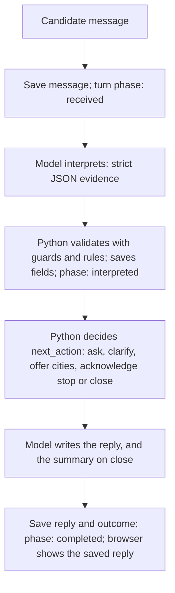

# Grupo Sazón: candidate screening agent and recruiter tool

Grupo Sazón hires delivery drivers: about 1,000 applications a week, 13 recruiters phoning by hand, 60% of candidates not answering and 80% of recruiter time spent on unqualified people. This repository has two products: a **screening agent**, a web chat that collects and validates the seven screening fields, and a **recruiter tool** that lists the results and records a decision. **It is a local demo, not production-ready: recruiter routes are unauthenticated.**

Phase 1 deliverable: **[process design](docs/design/process-design.md)**. Real transcripts: **[sample conversations](docs/evals/sample-conversations.md)**.

## Setup

Prerequisites: Git, Python 3.13, Node.js 22 with npm 10, and an OpenAI API key. Verified on Windows with Python 3.13.7, Node.js 22.17.0, npm 10.9.2 and Git 2.50.0. Direct Python dependencies are pinned; transitive ones are not.

In PowerShell (verified):

```powershell
git clone https://github.com/liberto6/PruebaOrbio.git
Set-Location PruebaOrbio\app
python -m venv .venv
.\.venv\Scripts\Activate.ps1
python -m pip install -r requirements-dev.txt
Copy-Item .env.example .env    # Then edit app/.env and set OPENAI_API_KEY
Push-Location frontend
npm ci
npm run build
Pop-Location
python -m uvicorn backend.main:app --reload
```

macOS or Linux, **not verified**: the same steps, with `cd PruebaOrbio/app`, `python3 -m venv .venv`, `source .venv/bin/activate`, `cp .env.example .env` and `(cd frontend && npm ci && npm run build)`.

Open the **candidate chat** at http://127.0.0.1:8000 and the **recruiter tool** at http://127.0.0.1:8000/recruiter. Opening the chat creates an application. **Each chat message calls the paid real model**; a scripted conversation in the final tuned battery averaged about 0.001 USD.

From `app/`, tests need no key and make no network calls. Evals are optional, call the real model and **cost money**:

```powershell
python -m pytest
python -m evals.run                                            # Tuned battery, about 0.11 USD
python -m evals.run --held-out                                 # Held-out battery, about 0.06 USD
python -m evals.run --only guadalajara,no_license --repeat 3   # Scenario names containing these parts
```

Evals save results in `docs/evals/`, and the runner refuses to start once those files add up to 2 USD (now 1.55).

- **Activation blocked by PowerShell:** activation is optional. Use `.\.venv\Scripts\python.exe` instead of `python`.
- **No key:** the app starts and saves messages, and the chat says the service is unavailable. Restart Uvicorn after editing `.env`, then retry the message.
- **No build:** `/` and `/recruiter` return a JSON 503 with the build commands, and the API stays up. Restart Uvicorn after creating a build. Check the server with `Invoke-RestMethod http://127.0.0.1:8000/api/health` (status `ok`).
- **Configuration:** the database is `app/data/screening.db`, created at startup and ignored by Git. `SCREENING_DB` overrides it, with relative paths resolved against `app/`. `SCREENING_MODEL` is optional.

## Architecture

One FastAPI process serves the API and one React build. One candidate turn, where every saved step commits in one SQLite transaction:



| File | Owns |
|---|---|
| `app/backend/main.py` | HTTP routes, candidate and recruiter projections, stable error codes, serving the build |
| `app/backend/conversation.py` | `next_action`, turn phases and retry, place guards |
| `app/backend/rules.py` | Field models, validation, coverage catalog, clarification limit, outcome evaluation |
| `app/backend/storage.py` | SQLite tables and transactions, turn phases, reminder eligibility |
| `app/backend/llm.py` | `ScreeningLLM` contract, extraction schema, prompts, OpenAI adapter, failure mapping |
| `app/frontend/src/` | `main.jsx` (chat) and `Recruiter.jsx` (`/recruiter`), one build, plain JavaScript and CSS |
| `app/evals/`, `app/tests/` | Real-model runner and scenarios, outside pytest; the pytest suite |

**Routes.** Chat routes (`/api/applications...`) return an explicit allowlist: messages, language, closure, pending turn and reminder deadline, never the fields or summary. Recruiter routes (`GET /api/recruiter/applications`, optional `outcome` and `recruiter_decision` filters; `GET .../{id}`; `PATCH .../{id}/decision`) read the saved records through `storage.py`, never call the model and need no key. A decision changes nothing else. The screen reads the whole list once and files it into folders by decision (Bandeja, Avanzadas, Descartadas).

**Storage.** `applications` has the outcome and decision as columns and the candidate as a JSON `snapshot`; `messages` holds the full history; `turns` holds the phase of each request.

**Structured output.** The model answers a strict JSON schema (`Extraction` in `llm.py`); Python turns it into `fields`, where all seven keys always exist. Each has `raw`, `normalized`, `status` (`missing`, `resolved`, `unresolved`), `reason` and `clarifications_asked`. Next to `fields` are `outcome`, `outcome_reasons`, `pending_questions`, `summary` and `recruiter_decision`; the recruiter detail route returns them. The `normalized` values:

```json
{
  "full_name": "Luis Romero Vega",
  "driving_license": true,
  "work_locations": {"identified": [{"country": "ES", "locality": "madrid"}], "unresolved": []},
  "availability": {"options": ["full_time"], "notes": null},
  "preferred_schedule": {"options": ["morning"], "notes": null},
  "delivery_experience": {"years": 2.0, "platforms": ["Glovo"]},
  "start_timing": {"kind": "date", "value": "2026-12-01"}
}
```

## Key design decisions

- **OpenAI `gpt-6-luna`.** Economical (0.10/0.50 USD per million input/output tokens), with strict structured output, and a probe call worked. Gemini Flash's free quota could not be confirmed and its only probe timed out at 60 s. *Trade-off:* selection was kept simple: no other provider was compared head to head. It proved cheap (110 runs for 0.11 USD, median turn 3.6 s), but four calls took about 243 s in one run, cause not investigated, and prompt rules are not always followed. Another provider needs a new adapter.
- **The model converses, Python decides.** A wrong outcome is the costliest error and candidate text must not change the rules, so outcomes come only from `rules.py`, which is testable without a model. *Trade-off:* two model calls per turn, and a wrong extraction can still give a wrong outcome. "Sí, tengo coche" counts as holding a licence, a false qualification risk accepted by decision.
- **Closed city list plus contradiction guard.** The model picks covered cities from a closed enum and reports others as stated, so it cannot invent coverage. But any listed city is a valid answer: one run saved Valencia for the north of Monterrey. So a city is refused when no candidate message names it and the latest one names another. *Trade-off:* a wrong city passes if the candidate names no other, and places outside the list are not checked. There is no geocoding, so a nearby town counts as uncovered.
- **Turn phases and retry from saved state.** A turn makes several calls that can fail separately. Resending the same `request_id` and text resumes the saved phase, so a retry or lost response neither duplicates a message nor loses an answer. *Trade-off:* a `turns` table and more code than a plain chat; concurrent retries can repeat a paid call, though not its database effects; a reply that keeps failing holds the turn.
- **SQLite.** No server to install, and real transactions for the phases. *Trade-off:* one writer at a time, no migrations (new snapshot keys get defaults), and fields inside the JSON cannot be indexed. It does not fit real volume.
- **Local React build served by FastAPI.** One process, one origin and no CORS, so a reviewer starts one command. *Trade-off:* Node is needed to build, Uvicorn must restart after a first build, and there are no frontend tests.
- **Never reject on a doubt.** A false rejection can lose a valid candidate, while a doubt costs one recruiter look. Rejection needs an unequivocal no, or an uncovered place after one offer of the covered cities. After the clarification limit (two per field, one for start date) the doubt goes to `pending_review`. *Trade-off:* extra turns and recruiter work, the client's own pain point, so evals count unnecessary review.

## Assignment coverage

| Core requirement | How it is met | Where |
|---|---|---|
| Language | Python 3.13 backend; JavaScript only for the browser screens | `app/backend/` |
| LLM | OpenAI `gpt-6-luna`, justified above | `llm.py`, [E3 plan](docs/planning/e3-conversational-agent.md) |
| Conversation | The model writes each message for the action Python chose, following the Phase 1 stages | `REPLY_PROMPT`, `next_action` |
| Data extraction | Strict JSON schema; all seven fields always present, with raw and normalized values | `Extraction`, `CandidateFields` |
| Validation | Invalid or ambiguous answers are saved as unresolved and asked again, rephrased, then with options | `rules.py`, `next_action` |
| Context | Full history saved; the interpreter gets all of it, a reply the last six messages plus saved fields | `messages` table, `llm.py` |
| Storage | Conversations and extracted data in SQLite, the data as JSON | `storage.py` |
| Summary | Generated at close, saved, in Spanish, shown only to the recruiter; incomplete applications have none | `write_summary` |
| Error handling | Unusable model output asks the candidate to repeat; provider failures keep the turn for retry; stable error codes | `conversation.py`, `main.py` |

Bonus features built:

- **Multi-language.** Detects a request or a whole message in the other language and continues in ES or EN with the same data. One isolated word does not switch. Same-sentence code-switching is not built or scored as such. The greeting and the summary are always Spanish.
- **Guardrails, basic.** Candidate text is passed as data; evals include injection scenarios and one insult, which is not broad coverage. The prompt forbids inventing job terms. Candidate responses omit internal data, logs hold codes rather than message text, and model calls use `store=False`. Messages do reach the provider, and the chat does not tell the candidate.
- **Re-engagement.** One fixed reminder after 10 minutes of inactivity, only while the page is open. Nothing is sent with the browser closed.
- **Tests and evals.** See below.
- **ATS integration design, design only.** [OpenAPI contract](docs/design/ats-api.yaml) and [explanation](docs/design/ats-integration.md). No connector exists, and it was not tested against any ATS.

Not built: voice, sentiment analysis, analytics, interview scheduling, deployment design and RAG. Job questions are saved for the recruiter, not answered.

## Tests and evals

`python -m pytest` reports **802 passed**. The [final batteries](docs/planning/e4-5-agent-tone.md#final-batteries-before-e5) on the delivered prompts gave **109/110 tuned** and **70/74 held-out**, with no false rejection, false qualification or unnecessary review counted. This is a small scripted acceptance set, and one held-out failure did motivate the city guard. **The runner does not score tone**: read the transcripts for that. Known limits, left in place by decision:

- A reply occasionally appears twice in one message, once with stray characters (2 of about 800 replies, cause unknown).
- A job question in the last turn can be answered but not saved, so the recruiter does not see it (1 of 3 runs).
- A job answer can repeat on the next turn (1 of 14 runs with a job question, found by reading).
- An extra location question can appear instead of saving the city (1 of 3 runs); no wrong city was saved.
- Acknowledgements are repetitive ("Perfecto"), and a correction may go unacknowledged.

The other runner failure is a scorer gap on the spelling "carné". Further limits are in that section and in the stage plans.

## Potential improvements

1. **Production minimum** (from the process design): recruiter authentication, a notice to candidates about their data, retention and deletion, and a message length limit.
2. **The real no-answer problem:** a server-side reminder and a channel such as WhatsApp, since nothing reaches a candidate who left the page. The 8-city catalog is fictional against the client's 45 locations.
3. **Agent defects:** save raw model output to find the doubled reply, save last-turn job questions reliably, try `WRITING_EFFORT = "low"` (untested), and add tone to the evals.
4. **Fewer wrong rejections:** a confirmation before a coverage rejection, and place resolution beyond the list.
5. **Recruiter and quality:** job facts or RAG for candidate questions, analytics on drop-off, frontend tests.

**Scaling to 10K candidates a week** (about one a minute on average, with peaks). At about 0.0017 USD per completed scripted screening, the median of the saved qualified runs, the model costs about 17 USD a week. That is an extrapolation from synthetic runs, but cost is not the constraint. It would require Postgres with indexed fields instead of SQLite; several app instances, which the saved turn state allows; model calls in a queue with bounded concurrency instead of held HTTP requests, plus provider limits and a fallback; server-side pagination and folder counts; a scheduler for reminders; monitoring of cost, latency and drop-off; evals in CI with larger samples; and the [ATS sync](docs/design/ats-integration.md#what-a-future-implementation-must-add).

## Sample conversations

[Five real transcripts](docs/evals/sample-conversations.md), copied by script from one eval run: **qualified**, with an imprecise start date clarified once; **early rejection** for no licence; **covered cities offered** after an uncovered city; **pending review** for an unresolved Guadalajara; and **stop and resume**, with a job question while stopped.

## Project map

- Design: [process design](docs/design/process-design.md), [flow diagram](docs/design/conversation-flow.html), [ATS contract](docs/design/ats-api.yaml), [ATS explanation](docs/design/ats-integration.md).
- Planning and verification evidence: [roadmap](docs/planning/build-roadmap.md), [E1](docs/planning/e1-foundations.md), [E2](docs/planning/e2-rules-and-persistence.md), [E3](docs/planning/e3-conversational-agent.md), [E4](docs/planning/e4-recruiter-tool.md), [E4.5](docs/planning/e4-5-agent-tone.md), [E4.6](docs/planning/e4-6-ats-integration-design.md), [E5](docs/planning/e5-delivery.md).
- [Assignment](docs/assignment.html); eval results in [`docs/evals/`](docs/evals/). Fraunces and DM Sans are bundled under the OFL in `app/frontend/src/fonts/`.
