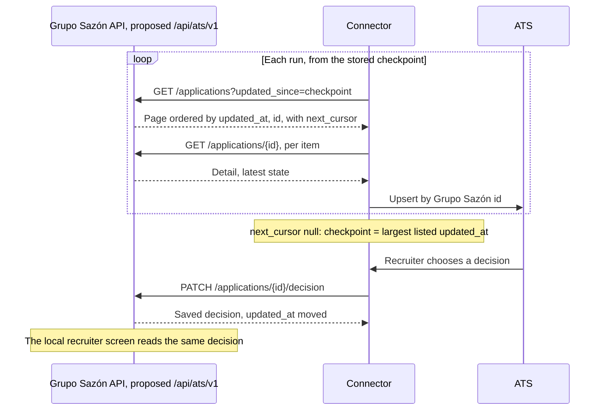

# ATS integration design

**Proposed, not implemented.** None of this runs in the demo: no routes, no connector, no
change to the application. The contract is [`ats-api.yaml`](ats-api.yaml). No ATS vendor is
chosen and no compatibility with a real one is claimed.

## The flow in one minute

Grupo Sazón keeps screening candidates; the agent and the recruiter screen stay as they are.
An external connector calls three proposed endpoints. Periodically, it lists the applications
changed since its last checkpoint, reads each one's detail, and creates or updates the ATS
record using our application id. Because it upserts by id, receiving a record twice is
harmless. So after any failure it simply restarts from its checkpoint, which only advances
when a whole run succeeds. When a recruiter decides in the ATS, the connector writes back
unreviewed, advance or rejected, and our local screen shows it. A decision never changes the
screening result. The API exposes latest state, not history, and delivery is at least once,
never exactly once.

## Responsibilities

- **Connector:** schedule, checkpoint, ATS field and status mapping, id correspondence, upsert.
- **API:** latest state in a deterministic order, and saving the decision. It does not sync.
- One id is one application, not a verified person. A second application stays a separate
  record, and people are never merged by name.
- A real vendor may require data this application does not collect, such as contact details
  or a job id. That needs mapping work; the contract does not invent those fields.

## Synchronization rules

1. **Order and bound.** Items are ordered by `updated_at`, then `id`. `updated_since` is an
   inclusive lower bound. Continuation pages send `cursor` instead.
2. **Boundary timestamps.** Records equal to the checkpoint come back on the next run. That is
   deliberate: a record with the same timestamp cannot be lost, at the cost of a duplicate.
3. **Changes during pagination.** A change moves a record forward in the order. Not yet
   delivered, it is found at its new position. Already delivered, it is delivered again.
4. **Checkpoint.** It advances once, when `next_cursor` is null, to the largest `updated_at`
   returned by the list. Never to a detail or decision `updated_at`, which could jump past
   records not yet listed, and never to the connector's clock. A run with no items keeps it.
5. **Failure.** Retry a page after 500, 503 or a network failure, with backoff. If it keeps
   failing, or the cursor is refused, end the run without moving the checkpoint; the next run
   starts from it and re-delivers. The initial import follows the same rules, without
   `updated_since`, and has no checkpoint until it completes. It includes greeting-only records.

Timestamps alone are not enough: this relies on the `id` tie-break, the upsert and rule 2.

**No decision echo.** Every saved decision moves `updated_at`, even with the same value, so
the connector keeps the last decision exchanged per id. It sends a PATCH only if the ATS
decision differs from that value and from the one just read. Sending on every sync would relist
the record forever.

**Lost responses.** Read the detail: if it has the intended decision, stop; otherwise send it
again. The same value has the same business effect, with no claim of an unchanged timestamp.
Only 500, 503 and network failures are retried; 401, 403, 404 and `invalid_request` need a fix
first.

## Worked example

Synthetic data, `limit=2`, stored checkpoint `09:00:00.000000Z` (all times 2026-11-05 UTC). The
records and their detail are the examples in the contract.

| Step | Call | Result | Connector |
|---|---|---|---|
| Run 1 | `GET ?updated_since=09:00…&limit=2` | `a1f0…` qualified 09:10:00, `b2e1…` incomplete 09:12:30.25, `next_cursor` | Reads both details, upserts both |
| | `GET ?cursor=…` | 503, and 503 again on retry | Ends the run; checkpoint stays 09:00 |
| Run 2 | `GET ?updated_since=09:00…&limit=2` | `a1f0…` and `b2e1…` again | Same ids: upserts update, no duplicates |
| | `GET ?cursor=…` | `c3d2…` pending review and `d4c3…` disqualified, both 09:15:00, `next_cursor: null` | Upserts both; checkpoint becomes 09:15:00 |
| Decision | `PATCH a1f0…/decision` `advance` | 200, `updated_at` 09:20:00 | Remembers `advance`; checkpoint stays 09:15 |
| Run 3 | `GET ?updated_since=09:15…&limit=2` | `c3d2…`, `d4c3…` (boundary), `next_cursor` | Upserts both, nothing to write back |
| | `GET ?cursor=…` | `a1f0…` `advance`, 09:20:00, `next_cursor: null` | Already `advance`: no PATCH. Checkpoint becomes 09:20:00 |
| Read | `GET a1f0…` | `advance`; fields, outcome, summary and `closed_at` unchanged | The local screen shows the same decision after loading it |

## What a future implementation must add

The contract describes behaviour the demo lacks:

- **Ordering.** A query on `updated_at` then `id`, comparing instants, with keyset cursors.
  Today's recruiter list sorts by `created_at`, without pagination, and the stored
  `updated_at` text omits the fraction on a whole second, so text order is not time order.
- **Timestamps in commit order.** `updated_at` must never decrease in commit order, or a record
  can land behind a checkpoint and be missed. Every update takes it inside the write transaction,
  but `create_application` takes it just before, and nothing guards against the clock stepping back.
- **Format.** UTC, `Z`, exactly six fractional digits, never rounded, so a checkpoint is sent
  back exact. Today's API returns `+00:00` and may omit the fraction.
- **Projection.** An explicit allowlist excluding the transcript, `clarifications_asked`,
  `revision`, `stop_requested`, `language`, `reminder_sent`, `last_question_field`,
  `last_question_kind` and `location_alternatives_offered`.
- **Access.** HTTPS, bearer credentials with read and write permissions, the 401 and 403
  responses, and the new `invalid_cursor` code.

Saving a decision already has this domain behaviour, on open and closed applications. The
proposed response adds `updated_at` and `outcome` to today's `id` and `recruiter_decision`.

## Limits

- Latest state only: no event history, decision audit or exactly-once delivery.
- The ATS is the authority for decisions: they travel from the ATS to Grupo Sazón only. A decision
  changed in the local screen is not copied to the ATS and lasts until the next ATS decision.
- Concurrent decisions follow the last committed write, including a local decision and a
  connector PATCH. There is no conflict detection.
- An open record may change: for example, a location is `unresolved` while the candidate answers
  an offer of covered cities. `reason` is an open code. Only closed records have a final outcome.
- Retention and deletion sync, and production security implementation, are out of scope.
